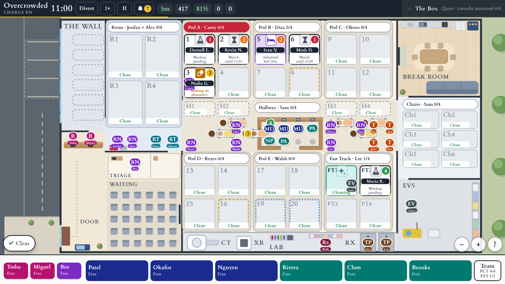
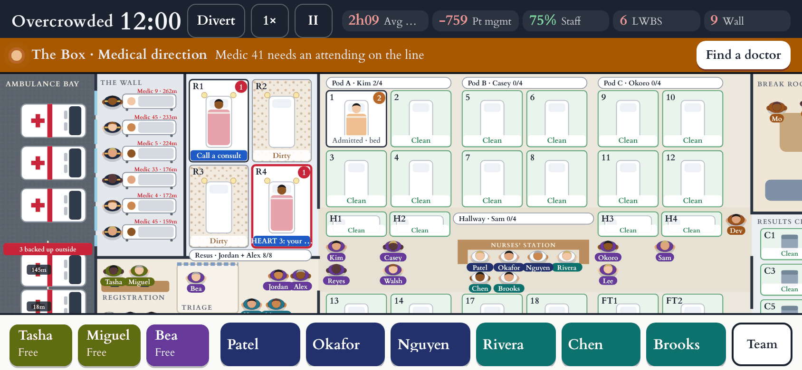
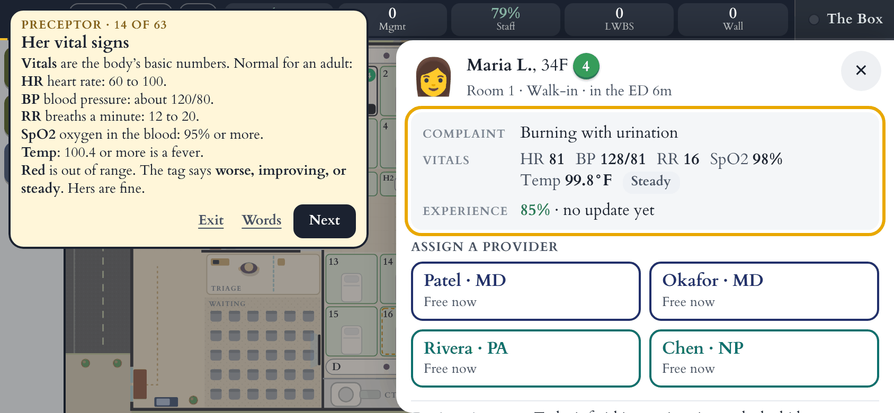
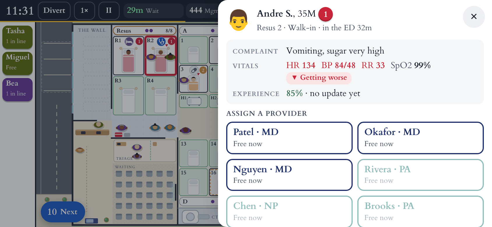
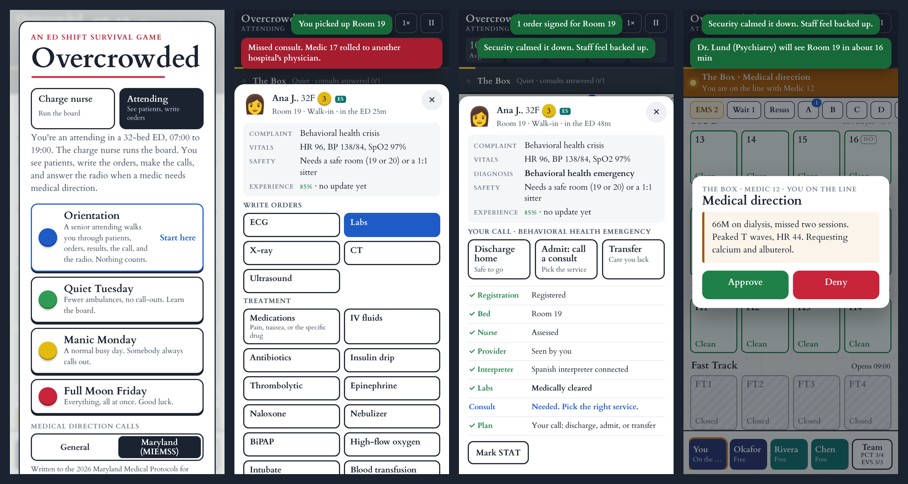

# Emergency Department: Code Black

An ED shift survival game. (It was called Overcrowded until v0.20.)

A 32-bed emergency department, 07:00 to 19:00. Patients come in by ambulance and through the front door, the radio keeps ringing, and an administrator just walked in. Pick your role on the menu:

- **Charge nurse.** You run the board: registration, triage, beds, providers, EVS, consults, and getting patients upstairs or out the door.
- **Attending.** The charge nurse runs the board. You see patients, write the orders, make the disposition call, and give EMS medical direction on the radio.

**Play it:** https://edcodeblack.com (password-protected during private testing; this repository is private since Nov 18, 2026) (also edcodeblack.net and the old address, https://mussidik1.github.io/Overcrowded-ED-Game/, which forward there)

## The floor plan

The department is drawn from above: a bed in every room, chairs in the waiting room and the results area, a nurses' station, a break room, and the ambulance bay outside. Everyone on shift is a person on the floor. Nurses stand by their pods, providers sit at the station, techs, EVS, and transport go where the work is, and staff on break sit in the break room. EMS crews hold the wall with their patients until a nurse takes report. When the wall is full, the next ambulances back up in the driveway, each with its wait time.

**It fits a phone held sideways.** The whole department is on screen at once, with no dragging. Scores run along a slim strip on top, registrars and the triage nurse sit on a rail at the left, and providers sit on a rail at the right. Each room shows one icon for what it needs: a blue stethoscope for "needs a provider," a phone for "call a consult," a broom for a dirty room. Filled, pulsing icons need you. Gray ones are waiting on someone else. Pinch (or use the + button) to zoom in and the icons turn into words, with name tags on the staff. Zoomed out, tap the waiting room, the line at the door, or the wall to pick a person from a list: tap the row to give them a bed, or Card to read their card. Zoomed in, a room's words wrap onto a second line before they are ever cut off.

**Every patient has a name tag.** Each occupied room shows the patient's name on a dark tag, at both zoom levels, drawn above the staff so a nurse at the bedside never hides it. The same tag is on the wall, in the waiting-room list, and on the list board. When a message says "Kwame E. is crashing," you can find Kwame.

**Taps forgive a sliding thumb.** A real fingertip moves during a tap. The floor takes a tap that slides up to 16 px, or a quick one up to 30, and a thumb resting on the glass does not block the other hand.

**Messages stay off the floor.** On the floor plan a message rides in the top strip, over the scores, one at a time. It never covers a room, a patient card, or what the preceptor is pointing at. The strip stays one line on every phone, even with the Box ringing, and a patient card opens under it, so the clock, the scores, and the Box stay in view and in reach.

On a laptop the same floor shows the words all the time, with the staff in a dock along the bottom. The list board is still there if you want it: switch in Settings or in the pause menu.

**People move.** Walk-ins come through the front door, stop at registration and triage, and take a seat. When you give someone a bed, they walk there, and ambulance patients roll in on the stretcher with their crew. Patients who go home walk out the front door, and admitted patients ride upstairs with transport. The light through the windows goes from morning to dusk over the shift.

**"Next."** A button counts everything that is waiting on you and names the most urgent one: a room that needs a provider or a consult call, a crew on the wall, the line at the door, the radio. Tap it (or press N) and it goes exactly there. Tap again for the next. When the Box rings it turns red and says so. A patient on the wall with two vital signs in red goes ahead of routine work. On a sideways phone it sits at the foot of the left rail, off the floor.

**Full screen and offline.** On Android, tap Full screen in Settings or in the pause menu. On an iPhone, add the page to your Home Screen (Share, then Add to Home Screen) and open it from there. After the first visit the game is saved on the device, so it opens with no signal.





**New here? Start with Orientation.** Each role has its own. It lights up what to tap, holds the clock until you act, and fast-forwards through the waiting. Skip it, and your first real shift opens with three lines to know, not the whole manual; How to play is one tap away.

**No medical background needed.** Orientation is written for someone who has never worked in a hospital, and it teaches the real game, not an easier one. Every short name is explained in plain words the first time it comes up: ESI, EMS, RN, PCT, EVS, the Box, MTP, ECG, CT, HEART score, boarding, divert, and the rest. It shows how to read a room and a patient card, including what each vital sign is and what a normal number looks like. A **Words** button on every preceptor card, in How to play, and in the pause menu opens the whole list: about 145 terms in plain language.

- **Charge nurse (67 steps):** the screen and your five scores, hallway beds, Fast Track, and the outlined rooms, a walk-in from registration to discharge, what the room icons mean and how to zoom in for words, the Next button, an ambulance patient through report, consult, admission, and transport, a trauma alert with massive transfusion, routing a medical-direction call to a doctor, a chest-pain call, chairs, waiting-room rechecks, an interpreter, breaks, a decision card, an equipment outage, a transfer, and the words you will hear on a real shift.
- **Attending (37 steps):** your five numbers (Wait, Score, Panel, To see, To do), reading a card and its vital signs, strep throat (see, order, discharge), DKA (treat what you find, admit to the ICU), appendicitis (a thin workup, the missing CT, call surgery), a medical-direction call on the radio, and a stroke alert from last known well to door to needle, with what the thrombolytic is and the pressure limit for it. The radio call in Orientation is in plain words whichever call pack is picked.

**Polish (v0.16.1).** Hallway beds and chairs have larger labels, and chairs read Ch1 to Ch6 so they are not taken for Pod C. The safe rooms' blue dots are darker, pod signs show their room range larger, and empty wall slots are easier to see. "The floor" now means upstairs only, the end screen is the shift summary, and "report" is the hand-off. Anaphylaxis and a COPD flare on BiPAP are ESI 1 (in any monitored room, and a PA or NP may see them with a co-sign); a TIA is ESI 2. The Maryland freestanding-ED call says plainly that the crew is on scene.

**The rest of the map polish (v0.16.2).** Room icons are rounded squares, so a blue icon is no longer read as a blue ESI circle. Staff at a bedside keep off the icon and the name tag. The DOOR label sits beside the line of people and clear of the Next button; the waiting-room seats sit below their label; the BREAK ROOM label is clear of the status chips. The bedding bar is one line under the bottom row of rooms. The map key adds the gray stethoscope, pod-sign dots and loads, and (for the attending) the house, broom, sparkle, and padlock. Tapping Next while a card is open goes to the next thing. Intake tags say their state (NEEDS REG, REG IN LINE, TRIAGE NOW, REG ✓). The attending's exam shows the minutes left. The cath lab message gives the time the patient left and says the balloon time comes later.

**Messages (v0.16.3).** On the floor plan, the five scores stay on screen while a message shows: they drop their labels and slide left, and the message takes the rest of the strip. Routine news (a goal met, staff arriving, a patient off to the OR) skips the strip and is kept under a bell beside the pause button, which counts what is unread. Bad news, anything to act on, and the answer to a tap still show. Orientation and lessons show every message. On the smallest phones, or with the Box ringing, there is no room for both, and a message covers the scores as before.

**Safari's engine, spaced cases, earlier terms (v0.16.4).** A GitHub workflow (`.github/workflows/tests.yml`) runs the rule checks and the phone-size UI tests in WebKit, the engine behind Safari, on each push to `main`; the output is kept as `webkit.txt` on the `ci-results` branch. `BROWSER=webkit` runs any UI test in WebKit locally. A case that just arrived is unlikely to arrive again for 45 minutes, so a shift no longer brings three hip fractures before 08:00. Orientation explains EVS, the dots on a pod sign, CT, XR, LAB, RX, and the workup where they first appear; the card explains Experience and Mark STAT when Plain words is on.

**The 3D floor (v0.18.0).** The department is now drawn in 3D: a lit, detailed ED with real beds, monitors, curtains, and headwalls, modelled in Blender. People walk the halls in uniform (nurses in blue, techs in green, the attending in a white coat, the PA in burgundy, the NP in purple, registration in shirt and slacks, EVS in charcoal, EMS in navy). Patients lie in beds in gowns, wait on stretchers on the wall, and sit in the waiting room. Ambulances park at the bay and queue down the drive. Room colours are gone: each room shows an icon for what it needs next, pulsing when it is waiting on you, with the call light lit by the door; a crashing patient gets a flashing red ring. Drag to move, pinch or use + and − to zoom. Orientation and the lessons use the flat map, and the flat map is one tap away in Settings or the pause menu ("Floor: 3D / flat") for older phones.

**A simpler menu, a lighter 3D floor (v0.18.1).** The title screen is now three choices under the role picker: **Play a shift** (the four shifts, the class scenarios, and for the attending the medical-direction calls), **Learn** (Orientation, the lessons, How to play, and the word list), and **Settings** (board, floor, 3D detail, sound, plain words, full screen). Resume and Last summary stay on the main screen. The 3D models were rebuilt for phones: each room is 5 draw calls instead of 178, the department 4 instead of 446, the glass no longer makes the phone draw the scene twice, and the download fell from 13 MB to 7 MB (`tools/opt3d.mjs`). **3D detail** has four settings: auto (balanced on a phone, sharp on a computer, and a step down after four seconds of slow frames), sharp, balanced, and battery saver (no shadows, 30 frames a second). Patients who are lying down now roll to their room, upstairs, or out to an ambulance on a stretcher, and the 3D light follows the clock (a warm morning, gold late afternoon, dusk by 19:00) and dims to generator light in a power failure.

**v0.31.0: private class results.** Class results now go only to the instructor who made the code (and are stored in a database the game's developer runs). **Making a code** registers it with a private **instructor key** (16 letters and numbers) that stays hidden until you tap Show key, so the code can be shown to a class. The key is kept on that device; Class results lists every code you made there, with Results, Show key, Copy key and Forget. Only the key opens a code's results, on this device or another (typed in, kept only if you ask). Results are listed in the order they arrive, not ranked, with each student's own numbers (for an attending: patients seen and how many died, diagnoses, unsafe orders and their complications, and radio calls out of those offered; radio calls can differ between students on one code; a shift that ended early says when). The instructor can delete any result or all of them, and copy or download the list (CSV, with its caveats) for a spreadsheet. Students see no names. **Sending a result** asks for a first name or initials (letters in any script, with spaces, periods, hyphens, apostrophes and middle dots, and the joiners Persian, Sinhala and Malayalam keyboards add; no numbers), shows what will be sent, can't be sent twice, isn't lost by a reload, and the game asks before you leave a summary that hasn't been sent. Everything sent for a code is **deleted 30 days** after the code was made (14 days if nobody sends a result); the code itself is then held 30 more days with only its key's hash, so nobody else can take it. The list says results are **not for grading**: scores are self-reported, anyone with the code can send one under any name, and no licensed clinician has reviewed the clinical content. A code shows once the server has set up its results (or when the instructor chooses to use it without results, if the server can't), so it never changes in front of a class, and a shift tapped while a code is on screen asks first. The instructor key is masked when typed on a shared or projected computer, and anything typed is cleared when the sheet is opened again. Every network call gives up after 8 seconds and says why it failed. The **About** page's Privacy section says what is sent, who can read it (the instructor, and the game's developer who runs the database), how long it is kept and how to have it deleted, and the About page and Lessons say that **no licensed clinician has reviewed the clinical content yet**. The class code screen no longer scrolls sideways on a phone, a new code scrolls into view, and the summary's speed breakdown includes 3×. Behind the scenes: the database is in the repo (`supabase/`), results sit where the public key can't reach them except through checked functions, rate limits count per network, by the hour and the day, by a scrambled, daily-changing form of the address, the database rules run on a local PostgreSQL 17 in CI, and the deploy checks the live database before it publishes. This release works through audit findings R3-01, R3-02, R3-03, R3-13, R3-14, R3-15, R4-02 and R4-03 and two rounds of review of the fixes; `docs/audit/round4/STATUS.md`, `round5/STATUS.md` and `round6/STATUS.md` say what is fixed, what is only partly fixed, and what waits for later phases.

**v0.30.0: an audit, and the clinical fixes it called for.** Two rounds of review by six AI reviewers (Claude, role-playing an architect, a tooling engineer, a security engineer, a game interface designer, a player and an emergency physician), with an AI verifier checking each serious finding; the report is `docs/PRO_AUDIT.md`. **No licensed clinician has reviewed the clinical content yet**; that review is still to come. This release fixes the clinical problems found first. **Stroke:** the clot buster counts within **4.5 hours** of last known well; later needs advanced imaging this ED doesn't have, so here it is harm, and if the window closes before it goes in, the missed window is counted. **Chest pain:** aspirin is the first drug; ibuprofen and ketorolac are harm in a heart attack, and in chest pain until a troponin is back; nitroglycerin is standard care (not under a pressure of 90); opioids are neutral, and harm under 90; metoprolol is harm with signs of shock. **Unstable A-fib** needs the new **synchronized cardioversion** order, not fluids, and rate-control drugs are harm once the pressure falls; stable A-fib that started under 48 hours ago may be shocked back too. **Bowel obstruction:** metoclopramide is harm. **Bicillin** has its own menu, by shot in the muscle (IM) only. Harm messages now say **why** (and never give away the diagnosis). **Cardiac arrest** is modeled on the AHA algorithms: **ACLS** for adults and **PALS** for children (doses by weight), and a traumatic arrest treats its causes all at once. The rhythm and the reversible cause follow the patient (a clot, a tension pneumothorax, a bleed, low sugar, an overdose). When you run the code, each **rhythm check** is a card about two minutes of CPR apart, with a result card that shows the right call and why; your answers and how fast a doctor got there set the odds of a pulse coming back. Your own patient who arrests shows **Run the code** with a countdown, and an arrest nobody runs for 20 minutes is a death, counted in the report. Two new lessons, **Cardiac arrest** and **A fast heart that's crashing**, and new glossary words (VF, PEA, asystole, ROSC, the H's and T's). A class shift saved on an older version now says why it can't continue. Behind the scenes: tests that replay seeded shifts, class codes, saves and every answer key, plus rule tests that check the clinical content itself.

**v0.29.1: fixes from the v0.29 reviews.** **Where patients go:** the hospital has neurosurgery (it takes trauma), so subarachnoid hemorrhage, cauda equina and spinal epidural abscess stay here, and the older head bleed on a blood thinner calls neurosurgery. It has no cardiac surgery: cardiothoracic surgery takes a dissection by phone, and the patient transfers. **Orders:** women 12 to 55 need a pregnancy test in appendicitis, gallbladder, gastroenteritis, kidney stone, PE, bowel obstruction, mesenteric ischemia, dissection, fainting, urinary infection, DKA and the overdoses. A drug that does the same job the same way as the right one (another opioid, another NSAID, another antiemetic, steroid, benzodiazepine, second-line seizure drug, bronchodilator or crystalloid) "works, but isn't the first choice": it isn't scored as wrong, and it doesn't fill the order. A contraindicated drug counts as harm once. Ondansetron and acetaminophen are never wrong, unless the patient has a reason not to (acetaminophen in an acetaminophen overdose is harm). Potassium in DKA is allowed. Ampicillin is required in meningitis over 50. The clot buster in PE is contraindicated only while the pressure holds, and a new **massive PE** case needs it. Radio dose calls now offer near-miss wrong answers instead of silly ones. **Class codes** carry the game version, so a code from another version is almost always refused instead of becoming a different shift (the check is six bits: about 1 in 64 still gets through). A saved class shift from another version isn't resumed, and Run it back says so instead of starting a different shift. **Security:** class results from the database can't inject anything into the page, and the page has a Content Security Policy. **Checks:** every case is checked when the game loads, and a new test plays every case the textbook way and expects a clean score.

**v0.29.0: twenty high-yield, must-not-miss conditions (the first case chunk of the EM Model build).** Pulmonary embolism, aortic dissection, ruptured AAA, hyperkalemia, subarachnoid hemorrhage, bacterial meningitis, status epilepticus, cauda equina, ruptured ectopic pregnancy, testicular and ovarian torsion, small bowel obstruction, mesenteric ischemia, acetaminophen, salicylate and tricyclic overdoses, hypoglycemia, spontaneous pneumothorax, necrotizing fasciitis and spinal epidural abscess. Each arrives as a patient (chief complaint, vitals, exam), carries its own tests, right drugs and drugs that can hurt, and has a five-card lesson under its body system in Learn (29 lessons now). New tests (lumbar puncture, ESR and CRP, acetaminophen and salicylate levels, scrotal ultrasound), a chest tube, four specialists (vascular surgery, neurosurgery, OB/GYN, urology) and four drugs. They're written in a compact case format (`addCase`), so later chunks are data. The diagnosis call is cleaner: gray-zone patients keep their risk-score call instead of a quiz, choices read in one plain style, imaging results read as findings, plain-word glosses wait until the call is made, and drug labels show what a drug treats only in Orientation and lessons. Orientation now explains the call, accuracy and legal risk. Before release, three hostile reviews led to: treatments that need **more than one drug** (aspirin and heparin for a heart attack; calcium, dextrose and insulin for high potassium; a benzodiazepine then a second drug for status epilepticus; triple antibiotics for necrotizing fasciitis); standard add-ons that are fine (albuterol in hyperkalemia, anti-D in an Rh-negative ectopic); blood thinners treated as **one harmful class** for bleeding patients; a bedside aorta ultrasound, aortic and abdominal CT angiograms, a bladder scan, cardiothoracic surgery and midazolam; `addCase` checks every case at load (a case that can't be finished stops the build); plain-word glosses stay hidden until the attending names the diagnosis; the ECG sits beside the question; lessons list every drug a treatment needs; ECG rates match the monitor again; old saves load with the new specialists; class codes show the game version they belong to.

**v0.28.1: fixes from three hostile code reviews.** A patient waiting on your diagnosis shows "Name the diagnosis" on the map and in Next, the exam and results sit beside the question, and leaving it unanswered no longer hides an untreated patient. A drug that can hurt this patient (heparin in a GI bleed, IV-push epinephrine in anaphylaxis with a pulse) is harm, not an extra. Reasonable orders still need a sensible drug. Pacing pads can follow atropine. Getting fired keeps the case that did it in the review. Legal-risk steps blocked by another card show later; lawyers name a patient. The must-not-miss list is now dangerous diagnoses only. A missing radio call was restored; dose questions shuffle fairly and the summary shows the right order. Bots pick drugs. New drugs: glucagon, thiamine, pantoprazole, octreotide, acyclovir, cefepime, TMP-SMX, lidocaine, mannitol, hypertonic saline, RSI drugs, procainamide. Sign stays in reach on the order sheet.

**v0.28.0: built for emergency medicine residents (the first chunk of the 2022 EM Model build).** The attending's **order sheet is menus**: ECG and bedside tests, Labs, Imaging, Medications (twelve drug classes, about seventy drugs), a separate **Resuscitation drugs** set, Airway and breathing, Fluids and blood, and Procedures. Each case names the drugs that treat it; the wrong drug is counted and the patient stays untreated. When the results are back the attending **names the diagnosis** from four choices. A shift tracks **clinical accuracy** and **legal risk**, weighted by harm and must-not-miss misses: 25% brings a call from the administrator, 40% peer review, 50% a performance improvement plan with lawyers calling (refer them to risk management), and 75% ends the shift: the group lets you go. Ten new **radio calls ask for a dose or an order** (midazolam, adenosine, atropine, cardioversion, needle decompression and more), multiple choice. A new lesson, **Giving medical direction**, and the attending's lessons are grouped by body system. The plan for the rest is in `docs/em-model/PLAN.md`. `test/rules9.js` checks drugs, the diagnosis call, accuracy, legal risk and the dose calls.

**v0.27.0: the process steps from the ED workflow papers.** The ED doctor can **admit by phone**: for a straightforward medical admission the hospitalist accepts without coming down first (a surgical or heart problem still needs its specialist). About one consulted patient in five needs a **second consult**: a broken hip in an older patient gets orthopedics and the hospitalist; a GI bleed gets GI and the hospitalist. **Bedside tests**: a fingerstick glucose and a urine dip read in a minute at the bedside and still work when the lab is down; checking the sugar early on a stroke earns credit. **Screening at the door**: the first person to see a walk-in (quick registration or triage) screens for contagious illness; a positive screen means a mask and an isolation room, and a coughing patient left unscreened exposes the waiting room. A new flu case needs droplet isolation. `test/rules8.js` checks beds, transfers, help calls, weather, phone admits, second consults, bedside tests and screening.

**v0.26.0: beds upstairs, real transfers, a helipad, help calls, and weather.** Admitted patients now wait for a bed on their own unit: ICU, step-down, telemetry, med-surg or psych. A bed opens when someone upstairs goes home, and direct admissions from clinics and the OR compete for it. The **Beds** chip, top right, shows every unit. An ICU, step-down or psych patient with no bed can't stay: the doctor transfers them. A **transfer** is now four steps: find a hospital on the list (what each can do, minutes by ground and by air), call it to accept, pick the transport (wheelchair van, BLS, ALS, critical care ground, critical care flight), and give the crew report. Too little crew refuses at the bedside; too much wastes a unit; a flight is for time-critical patients. A **helipad** sits across the road: the helicopter lands, the flight crew walks in for report, and they fly the patient out (tap "Helicopter on the pad" to watch). Ground crews park in the bay and do the same. **Anesthesia** and **critical care** come down when called: anesthesia makes a hard airway safe. **Weather** (clear, rain, snow, fog, storms) changes who comes in, how fast ambulances drive, and whether helicopters fly; class codes always play clear. Mild pneumonia gets a **CURB-65** call. Patients in CT or X-ray show on the scanner table.

**v0.25.0: four scores, a waiting meter, a unit secretary, and rehab.** The single score is now four: **Patients** (how they feel about the visit), **Clinical** (the right care, on time), **Admin** (flow and cost) and **Staff** (team morale). The summary shows a card for each. A **meter** by the zoom buttons counts patients waiting on their next step: green at 1 or 2, yellow, then red, and shaking past 10. Tap it for the list. **Lena, the unit secretary** (UC), takes clerical work you hand her: calling a ride, or calling families with an update. Some older patients aren't safe to go home: **discharge them to rehab**, have UC call the ride, and a BLS crew comes to pick them up. **Consultants** now come down in the elevator, see the patient at the bedside, and go back up, on the flat and 3D floors. The menu says **Select role**, the charge nurse **manages ED flow**, and Learn runs from the introductory orientation to disease-specific lessons.

**v0.24.1: a screen tour and a tighter floor.** Orientation opens with two cards on the screen itself: the menu (pause, restart, settings, and **3D floor: on/off**) and the bell (Events) and **?** key. While the 3D floor downloads, a "Loading the 3D floor…" label shows over the flat map, so the switch isn't a surprise. The outside trees are gone, plain ground replaces the gray void, the camera is a little more top-down and frames just the building and the ambulance stalls, and zoomed in you can pan to the edge of the department but not past it. "Nothing counts" is gone everywhere.

**v0.24: fewer words.** Every Orientation and lesson card was cut and rewritten in plain, short sentences: 170 cards went from about 6,000 words to about 4,100 (the charge nurse Orientation reads 1,741 words, was about 2,160; the attending's 914; the longest card is 48 words, was 68). Same steps, same taps, every term still explained once. How to play, the map key, the welcome page, the first-shift card, the chapter cards, and a few long entries in Words and the order notes were cut the same way.

**v0.23.1: a sharper battery saver, and the crew waits for the ambulance.** Battery saver now draws the 3D floor at pixel ratio 2 (it was 1, which looked blurry on a phone with a 3x screen); it still saves power with no shadows and 30 frames a second, less work per second than balanced (1.5, shadows, 60). A patient who arrives by ambulance stays out of sight until the ambulance has parked, then shows on the wall (flat and 3D; at most 12 seconds; not in Orientation or lessons, where the preceptor points at the wall right away).

**v0.23: arrivals, nudges, and ambulances that park.**
- **New patients pop up.** Each arrival shows for about four seconds at the bottom left of the floor, the corner with the door and the bay: name, age, complaint, and "Walked in" or "Medic 7 at the bay". Taps go straight through it. An alert at the bay already takes the top strip, so it isn't shown twice.
- **Events.** The bell is now Events: everything the shift sent, newest first, arrivals included.
- **Icons that need you shake.** On the flat floor and in 3D, an icon waiting on you swells a little and gives a quick shake every couple of seconds. Reduced-motion settings turn it off.
- **Ambulances drive and park.** In 3D an ambulance comes up the road with its light bar flashing, pulls past its stall, swings its nose out, and backs in, so the back doors face the building. Leaving, it pulls out and heads down the far lane. On the flat floor it drives up the lane facing the way it goes, then backs into the stall. A parked ambulance keeps its stall when the one ahead leaves. `test/events_test.py` covers all of this on the flat floor; `map3d_test.py` checks the 3D drive.

**v0.22: a welcome page and a lighter 3D floor.**
- **Welcome page.** A first visit opens on a short page: what the game is, who it's for, that it's a teaching game and not clinical guidance, privacy (progress stays on the device; class results only when you tap Send), and credits for the 3D models, the font, and every medical image. Start goes to the menu. Later it's **About** on the menu. Automated test browsers skip it (`navigator.webdriver`); `test/about_test.py` checks it as a person would see it.
- **Lighter 3D.** The character skin textures went from 512 to 256 pixels (each person is at most about 60 pixels tall on a phone): the people folder dropped from 5.2 MB to 2.1 MB, and the whole 3D folder from 7.3 MB to 4.2 MB.

**v0.21.1: private testing.** On edcodeblack.com the game asks for a password before it starts. The password check and the on/off switch live in the database (`cb_gate`, `cb_gate_check`, `cb_gate_on`), so the gate comes down at launch with one database change and no new release. A device that has the password remembers it. The game's files still load before the password screen, so this keeps out visitors, not someone set on reading the code.

**v0.21: class results, neutral capacity alerts, a link preview.**
- **Class results.** After a class-code shift, the summary has a box to send the result to the class (a first name or initials). Under Play a shift, Class code, an instructor types the code and sees everyone who sent a result, best score first (since v0.31.0: private, and unranked), with stars, real time played, average wait, and walkouts. The results live in a Supabase table that can only take new results and give back the results for a code it is asked for.
- **ED Full and No Monitored Beds** replace Yellow and Red Alert. Places name these differently, so the game uses plain names.
- **3D.** Battery saver is the default detail (sharp, balanced and auto are in Settings). A tap anywhere in a room opens the room unless it lands right on a person. The triage curtain is gone: from the game's camera it looked like a floating diamond.
- **Imaging.** New pictures: the left M1 occlusion on CT angiography (CC BY 4.0, BMC Neurology via Open-i), a normal abdomen and pelvis CT, cervical spine CT, lumbar spine MRI, and pelvis X-ray. Still text only: normal CTA, normal CT pulmonary angiogram, normal leg-vein ultrasound, normal pelvic ultrasound.
- **Wording.** Contractions and plain phrasing through the game's messages, cards, and results.
- **A link preview** for edcodeblack.com: a title and picture when the link is shared.

**v0.20: bed first, class codes, 3D everywhere.**
- **Bed first.** A walk-in at the door who looks sick enough (ESI 1 or 2, or triaged that way) can go straight to a room before registration. Their card then asks for a registrar alongside the provider, and they cannot leave the ED until a registrar has been to the bedside. Alerts and codes are roomed first as before, and a free registrar still comes to them without being sent.
- **The menu, top right.** The button in the top-right corner opens the menu: Resume, Restart this shift, Main menu, and the settings. Opening it pauses the shift.
- **Orientation and lessons on the 3D floor.** The preceptor's rings and camera moves now work in 3D. Rooms in 3D carry the floor plan's colours on their floors and badges: blue needs you, green is ready to go, brown is dirty, purple is waiting for a bed upstairs.

**Real imaging (v0.19.1).** Imaging results now come with real studies: chest X-rays (normal, right lower lobe pneumonia, heart failure, COPD, a tuberculosis cavity), bone X-rays (hip, femur, and wrist fractures; a normal ankle and hip), CT (normal head, subdural hematoma, appendicitis, a ureteral stone), a normal brain MRI, and ultrasound (positive and negative FAST, gallstones, a normal gallbladder, a leg-vein clot). Tap the picture on the card for the full screen view: the finding, what to look for, and the picture's credit, linked to its source. Twenty pictures, all from Wikimedia Commons under CC0, public domain, CC BY, or CC BY-SA; see `img/CREDITS.md`. The CT angiogram of a blocked artery has no picture yet and shows as text.

**Real orders for the attending (v0.19.0).** Labs are single tests in groups: blood counts and chemistry (CBC, BMP, liver tests, lipase), heart and clots (troponin, BNP, D-dimer), infection and breathing (lactate, blood cultures, blood gas, viral swab, rapid strep), bleeding (coags, type and screen), and urine and other (urinalysis, pregnancy test, tox screen, CK). Imaging is a named study: X-ray (chest, pelvis, hip, limb), CT (head, CT angiogram of the head and neck, C-spine, CT angiogram of the chest, abdomen and pelvis), MRI (brain, spine), and ultrasound (FAST, gallbladder, leg veins, pelvic). Every case scores its own tests (`NEED` in `engine.js`): a needed lab is +1 and a needed study +2; a reasonable one is free; an extra lab is −1, an extra X-ray or ultrasound −2, an extra CT −6, and an MRI nobody needed −8 and about an hour off the floor. A missing test holds the diagnosis, as before. Each test has its own result (`RES`), and a study's result has a picture you can open full screen, with what it shows and what to look for. The charge nurse's cards show the provider's named tests too. The 3D floor now loads when a shift starts, not behind the menu.

**Cleaner labels (v0.18.2).** Zoomed out, each room's label is a small badge that fits inside the room: its icon, the ESI dot, and the room number. Zoom in and the full label with the patient's name comes back (the switch is made by how wide a room is on screen). A tap on the 3D floor no longer opens a card and then closes it with the browser's follow-up click.

**Tokens and a human voice (v0.17.0).** The map is drawn as tokens. A room is a tile whose colour is its state: solid blue needs you, red is trouble, green is ready to go, brown is dirty, purple is admitted and waiting for a bed, white is someone else's move, gray is empty. Each tile has one large icon; zoomed in, the name and the next step are in words. Staff are pills in one strong colour a role, lettered MD, PA, NP, RN, T (tech), R (registration), EV (housekeeping), RT, Rx, and TP (transport). Patients on their feet are circles with their triage level, or a question mark before triage. The beds, monitors, and little people are gone. The map key lists the colours, the icons, and who is who. The preceptor's cards in both Orientations and the eight lessons were rewritten to sound like a person talking, and the 32 radio calls now read as a medic speaking ("I'd like to give nitroglycerin").

**What six reviewers found (v0.16).** Six AI reviewers (Claude, role-playing three lay players and three clinicians: an emergency physician, an EMS physician and an ED charge nurse) reviewed v0.15. They were not real people, and no licensed clinician has reviewed the game. This release builds their clinical fixes and the feedback they asked for.

- **Trauma.** A bleeding patient in shock is no longer scored for a CT. X-ray, a bedside ultrasound, labs, blood, and the OR. The Bleeding lesson says so.
- **DKA.** The labs show the potassium, and insulin waits for it.
- **A watch before going home.** A treated overdose is watched two hours, an asthma attack one, anaphylaxis four. The card says until when and why. The charge nurse can move the patient to a chair, or discharge early and own the risk. Every 72-hour return is listed on the shift report with what would have prevented it.
- **Reasonable orders.** An order can now be reasonable: not required, not counted against you. An ECG in a stroke or a hip fracture, antibiotics for a gallbladder or an appendix, a dose of the usual pill for a refill, and a few more.
- **Triage levels.** Overdose, complete heart block, and the airway burn are ESI 1. Behavioral health is ESI 2. An overdose may take any monitored room. A neck injury gets a CT, not an X-ray and a CT.
- **Lessons match the scoring.** Heart (chest X-ray when it is not a STEMI), Belly, Falls, and Breathing. Reason lines explain every scored order and name the drug behind Medications.
- **Say what happened.** With Plain words on, an incomplete workup names what is still needed. The call sits above the order buttons. A wrong consult stays on the card and in the log. The bar says why no room will take a patient. The attending's report lists radio calls missed or answered wrong.
- **Radio.** Every plain line ends with what the crew is asking for. Refusal calls ask "Can he refuse?" with buttons "He may refuse" and "No: transport". Four calls were corrected (angioedema, sepsis, a right-sided heart attack, a seizing child).
- **The first shift.** The first tap in Orientation is card 4, not card 9. The card after chapter 1 says what a Quiet Tuesday will add.
- Full Moon Friday takes 2,000 points for three stars (was 2,200): the watch periods hold rooms longer.
- The build stops if a script does not parse.

**Learn in pieces, and see why (v0.15).** Twelve changes from the lay review and the screen audit.

- **The floor reads at a glance.** Each pod sits on its own tray with 8 between rooms and 17 between pods. Room outlines are drawn inside the room and are twice as heavy. Labels are larger and darker. Each pod sign carries its room numbers (A 1–4). The wall, the waiting room, and the door carry a count. The D, E, and Fast Track signs sit above their rooms. Hallway beds are dashed boxes. The attending's own patients get a gold ring. A **?** button on the floor opens the legend.
- **Orientation in chapters.** Charge nurse: The basics, Ambulances and admissions, Alerts and the Box, A full department. Attending: The basics, Sicker patients, The radio and a stroke. A card between chapters offers Quiet Tuesday. Once one chapter is done, the title row opens the chapter list.
- **Eight lessons.** Belly pain (gallbladder: ultrasound, not CT) and Falls (the hip, the head, and the blood thinner) join the six.
- **Exam findings.** After the exam the card shows what the provider found, one line for each of the 53 cases.
- **What was missed, and why.** With the diagnosis in, the attending's card says why that workup was the right one and names any order that was not needed. The shift report lists each patient with missed and extra orders and the reason. The wrong consultant says who to call. Penalties are unchanged.
- **Plain words, as a setting.** Results carry a plain line ("Hgb 11.9 · blood count a little low"). Each of the 32 radio calls has a plain line under it, and the answer leads with the plain reason. The clinical text stays. Switch it off in the pause menu or at the bottom of Words.
- **Words has a search box.**
- **The shift report** says what each star takes and how far the next one is, and folds the long tables under "All the numbers". Printing opens them.

**Lessons: one condition, two minutes (v0.14).** Under Learn on the menu. Six short lessons (eight since v0.15), each one patient from arrival to disposition, played as the attending whichever role is picked: **stroke** (clot or bleed, the 185/110 limit, door to needle), **heart attack** (the ECG, a STEMI alert, door to balloon, and the chest pain that is not a STEMI), **sepsis** (fluids, antibiotics within the hour, a vasopressor, the ICU), **bleeding trauma** (shock, blood before he arrives, the OR), **trouble breathing** (wheezing, wet lungs, or infection, and what each needs), and **overdose** (naloxone, and why he is watched). Each explains every term it uses, lights up what to tap, meets its own time goals when followed, and ends with the short version and what the charge nurse does for that patient.

**Short prompts, key words in bold (v0.13).** Every preceptor card, the first-shift card, and every decision card is written in short sentences, with the term being taught and the thing to tap in bold and one idea to a line. No card runs past 62 words; the longest used to be 94. A patient's name in a prompt wears the same dark name tag it wears on the floor. A card that only narrates waits long enough to be read before it moves on.

**What three lay reviewers could not work out, fixed (v0.14).** Every test and treatment on the attending's order sheet has one plain line under it, and Medications (pills, shots) is told apart from Antibiotics (by vein). Every consult service says what it covers. A diagnosis has its plain words under it ("Cholecystitis: an inflamed gallbladder"). The attending's five numbers are taught. A patient who is improving but still missing an order is no longer called "not improving". On the wall, a patient's card stays open for the second of its two intake steps. "The floor" means upstairs and nothing else; the preceptor's button reads "Got it", so "Next" is one button. On the upright list board a room tile shows the patient's name tag in full, and the ESI 3 number on the floor plan is dark on yellow.

On a phone held sideways the preceptor's card sits beside an open patient card, not inside it, so what you are told to tap is always on screen.




## Vitals that change

Every patient card shows heart rate, blood pressure, breathing rate, oxygen, and temperature, and they move. A sick patient who waits gets worse: the heart rate climbs, the pressure sags, and the card says "Getting worse" and why ("no bed yet," "no provider yet," "treatment not given yet"). The label is read off the numbers: it says worse or improving only when someone watching the monitor would see it. Abnormal numbers that are not moving read "Not improving." Anything out of range shows in red. Walk-ins have no vitals until triage takes them. Ambulance patients arrive with the crew's set.

Treatment turns it around, each on its own clock: naloxone and epinephrine work in minutes, fluids and blood take about twenty. Antibiotics stop the decline but take hours to move a heart rate or a fever, so they get no credit they have not earned.

The numbers follow the case, not just the acuity:

- Oxygen is low only when breathing is the problem. A stroke, a GI bleed, or DKA arrives with a normal sat.
- Oxygen is an order now. Pneumonia and septic shock need it, and for any low sat it is never a wrong order. For patients who are not the attending player's own, a nurse who has assessed a low sat still puts oxygen on, and the card says "on oxygen."
- No case arrives with vitals that contradict its triage level. (A test checks every case.)
- An overdose arrives drowsy after the crew's naloxone, and its breathing slows again as the field dose wears off.
- A head bleed's pressure climbs while the heart slows.
- A stroke's pressure stays where it came in until someone treats it. About four in ten strokes arrive over 185/110, the limit for the thrombolytic. Those need blood pressure control first: the nurse holds the drug until the pressure is down, and it stays under 180/105 afterwards. The thrombolytic itself does not lower the pressure.
- Septic shock stays low on fluids alone and comes up on a vasopressor. A complete heart block stays slow until it is paced.
- A crash looks like what is wrong. Asthma crashes as breathing failure with the pressure intact, a bleed goes pale and fast with a normal sat, sepsis goes hot and low, a heart attack goes into cardiogenic shock. The diagnosis changes with it ("Asthma attack with respiratory failure"), so does what the patient needs, and nobody who crashed is sent home. The five risk-score cases do not crash.
- A bleed nobody treats does not sit still: with no fluids and no blood it goes into shock at 75 minutes and arrests at two hours.
- The ECG line reads the rate on the monitor: a heart rate of 127 is "Sinus tachycardia, rate 127," not normal sinus rhythm.
- A child's numbers are scaled to a child's normals, and flagged against them.



## For a class

- **Five-Minute Rush.** Two packed hours, 07:00 to 09:00, in about five minutes of play. It has its own stars.
- **Scenarios.** Pick one under Play a shift and any shift gets a named problem early on: **CT down**, **Bus crash** (a multiple-casualty incident: EMS asks what you can take, then a red tag comes by radio, then a yellow, then four greens, each wearing its tag), **Boarding** (extra admitted patients, slow beds upstairs), or **Short-staffed** (two more call-outs). The game says so at the start, keeps a "Scenario" tag on the status strip, and names it in the pause menu and on the report. Scenario shifts do not count toward your bests.
- **Print the report.** The shift report has a "Print or save as PDF" button. On paper it is just the report, with the role, shift, scenario, date, and a line for a name.
- **The last report is kept.** Leave the report by accident and it is still there: "Last summary" on the menu brings it back, after a reload too. "Run it back" starts the same shift again in one tap.
- **Class codes (v0.20).** Under Play a shift, Class code makes a six-character code (like KZR-R19) for a role, shift, scenario and pack. Everyone who types it plays the same shift: the same walk-ins at the same times, the same scheduled ambulances, the same events. The attending's radio calls come at different times for each player and can be different calls. Only what each player causes differs, such as a patient who walks out or an ambulance sent away on divert. Copy or share the code from the same screen. The shift summary shows the code, the real time played, and how many patients were bedded before registration, and has a Share result button. A mistyped code is caught before Start.
- **Class results (private since v0.31).** Making a code also gives the instructor a private **instructor key** (hidden until Show key). Students tap **Send** on their summary (first name or initials); only the key opens the results, under Play a shift, Class code, Class results. Students see no names. The instructor can delete results and download them as a CSV; everything sent for a code is deleted 30 days after the code was made. **Results are for discussion, not grades:** scores are self-reported, anyone with the code can send one under any name, and even on one code the outcomes can differ between players. No licensed clinician has reviewed the clinical content yet.
- **Without a code, every student gets a different shift.** Arrivals and events are random, so scores are for discussion, not for ranking students against each other.
- **Sound.** Monitors beep, the radio squelches when the Box opens, and the big moments (alerts, codes, massive transfusion) go out as an overhead page. Turn it off in Settings or in the pause menu.

## How a shift works: charge nurse

1. **Intake.** Walk-ins and EMS patients each need a quick registration and triage, and you direct both. At the front door registration comes first. On the wall the crew's report comes first: a nurse takes it without waiting for the registrar. Full registration happens later at the bedside. EMS crews wait on the wall until a nurse takes report. Walk-ins go to the waiting room after triage, where triage can miss: have a nurse recheck people who have waited, and walk the room to update them. Alerts and crashing patients can go straight to a bed.
2. **Beds.** Put triaged patients in rooms. ESI 1 goes to Resus, Fast Track opens at 09:00 and takes ESI 4 and 5, and airborne isolation needs Room 8 or 16. Rooms 19 and 20 are safe rooms. Six results-pending chairs free a bed for anyone a provider has already seen. Tap dirty rooms to send EVS.
3. **Providers.** Assign attendings, PAs, and NPs. PAs and NPs take ESI 2 to 5, with an attending co-sign on ESI 2. Intubations need an attending and an RT. A provider with a long line starts missing things. Station a provider in triage to work the waiting room.
4. **The Box.** EMS calls come in two kinds. Alert reports are notifications: take the report so the team is ready. Medical direction needs a doctor: tap Find a doctor, pick an attending who isn't in a code, and they give the medic orders.
5. **Workup and treatment.** Techs draw labs and do ECGs, pharmacy verifies meds, respiratory therapy runs breathing treatments and vents, and the blood bank runs massive transfusion. A stroke over 185/110 gets blood pressure control before the thrombolytic, septic shock gets a vasopressor, a head bleed on a blood thinner gets a reversal agent, and a complete heart block gets paced. Get interpreters for patients who need one.
6. **Disposition.** Discharge, consult and admit. Chest pain, fainting, and TIA patients come back with a risk score (HEART, Canadian Syncope Risk Score, ABCD2), and you make the home, observation, or admit call. Admitted patients wait for a bed upstairs, their nurse calls report, then you send them with a transporter or a tech; a hold nurse can take every admitted patient in the ED. Request transfers as soon as the diagnosis is clear, then book an ALS ambulance, critical care transport, or a helicopter; the patient holds the room until the crew arrives.

**When something breaks, divert for it.** The CT scanner, cath lab, trauma OR, lab, and power can go down mid-shift. Go on the matching status (CT Divert, STEMI Divert, Trauma Divert, or Internal Disaster) fast, and lift it when the fix is in. ED Full and No Monitored Beds (the capacity alerts; v0.21 renamed them from Yellow and Red Alert) are for when the ED is full, but watch the neighbors: when three hospitals are on capacity alerts at once, the region suspends them all. The full-capacity protocol sends admitted patients to inpatient hallways when the ED is packed.

Along the way: nursing ratios (an active resuscitation takes a nurse and a half), a new grad who isn't ready for Resus, staff morale and breaks, call-outs and sick staff, angry consultants, admin demands, AMA, 72-hour returns, equipment downtime, and a multiple-casualty bus crash: EMS asks what you can take, and the patients arrive with red, yellow, and green field tags.

**Charge nurse scores:** average wait (door to provider), patient management, staff satisfaction, patients who left without being seen, and EMS wall time. The shift report at 19:00 gives you up to 3 stars, then walks you through your three worst moments and the decision behind each, the numbers an ED director answers for (door to provider, length of stay, boarding, LWBS and AMA rates, door to balloon), patient experience, and staffing hours.


## How a shift works: attending

1. **Pick up patients.** Rooms marked Needs a provider are waiting for a doctor. Tap one, then See this patient. See the sickest first. Leave someone too long and another provider picks them up.
2. **Write orders.** After your exam, pick tests (ECG, labs, X-ray, CT, ultrasound) and treatment (medications, fluids, antibiotics, oxygen, breathing support, intubation, epinephrine, naloxone, insulin, a vasopressor, atropine and pacing, blood pressure control, a thrombolytic, a reversal agent, blood, massive transfusion, laceration repair), then sign. The card does not list a plan before your exam: working out the orders is the job. Order what they need and nothing extra. Extra tests cost time and points, a CT costs the most, and some treatments hurt people who don't need them.
3. **Close the gaps.** If the workup can't make the diagnosis, add what's missing. A patient who isn't improving needs a treatment you didn't order, and twenty minutes untreated goes on the M&M list. Read the vital signs. Order a thrombolytic for a stroke over 185/110 without blood pressure control, and the nurse holds the drug and you lose points until the pressure is treated. The card shows last known well and when the window closes.
4. **Make the call.** Discharge, call the right consultant to admit, or transfer. Chest pain, fainting, and TIA come with a risk score for home, observation, or admit. Sending a sick patient home is the worst call you can make.
5. **The radio.** When a medic needs medical direction, it rings for you. Answer, read the call, approve or deny. Alert reports go to the charge nurse.
6. **Alerts.** Your orders and your speed decide the time goals: ECG in 10, CT in 25, needle in 60, balloon in 90. Activate massive transfusion for a trauma that's bleeding out, even before they arrive.

The attending's score counts patients seen, clean order sets, right calls, time goals, and medical direction. Patients waiting on your orders or your decision cost you. The shift report lists your patients and your worst moments, not the nursing numbers.



A shift takes about 30 minutes at 1x, with 2x to 4x for quiet stretches. It saves on your device so you can come back to it.


## Medical direction packs (attending)

- **General** (default): common online medical control questions, not tied to one state.
- **Maryland (MIEMSS):** written to the 2026 Maryland Medical Protocols for EMS (effective July 1, 2026). A teaching tool, not a protocol reference. Follow your current protocols.

## Development

The game ships as one self-contained `index.html`, with the engine, UI, styles, and fonts inlined. The source is in `src/`:

- `engine.js`: the simulation (no DOM)
- `ui.js`: the phone-first interface
- `map.js`: the floor plan (SVG), built into `ui.js`. It also hands the 3D floor a snapshot of the department every frame and takes its taps
- `../src3d/map3d.js`: the 3D floor (three.js), bundled by `build3d.js` into `3d/map3d.js` and loaded only when the 3D floor is on. Its models are in `3d/`, made by the Blender scripts in `art/blender/`
- `style.css`, `index.template.html`

The build also writes `sw.js`, a small service worker that keeps a copy of the game for offline play. Its cache name carries the version and a hash of `index.html`, so every build replaces the old copy.

```sh
npm install      # fonts used by the build
npm run build    # writes 3d/map3d.js and index.html
npm test         # rule checks (rules.js to rules13.js, about 700 checks), then golden.js, the change detector
npm run db:test  # the class-results database on a throwaway local PostgreSQL (about 200 checks)
npm run db:live  # the live database's rules, from outside (the deploy runs it; not from a Claude cloud container)
npm run sim      # simulated shifts at several player speeds
npm run stress   # 188 shifts across every level and scenario: checks for stuck states and out-of-range vitals
python3 test/ui_test.py      # taps through every system in headless Chrome (Playwright)
python3 test/md_ui_test.py   # the attending: see, order, decide, the radio, the report
python3 test/map_test.py     # the floor plan on a sideways phone (93 checks): fits without dragging, rails, icons, name tags, sliding taps, the wall list, messages in the top strip, zoom and wrapped words, ambulances backing up, vitals, the Next button, Words, scenarios, the printed and kept report
python3 test/finger_test.py  # Orientation the way a real finger plays it: people moving, real time, touches that slide 12 px. MODE=md for the attending
python3 test/offline_test.py # serves the folder, installs the service worker, cuts the network, and reloads
python3 test/imaging_test.py # named orders, results, and the imaging viewer for appendicitis; every picture credited
python3 test/map3d_test.py   # the 3D floor on a real shift (served over http): loads, room and staff taps, zoom, switching back to flat
python3 test/train_test.py   # plays the charge nurse Orientation on the floor plan, tapping only what the preceptor lights up
MODE=md python3 test/train_test.py   # the same for the attending Orientation
LESSON=stroke python3 test/train_test.py   # one lesson: stroke, heart, sepsis, bleed, breath, od, belly, or falls. Fails if following it misses a time goal
CHAPTER=2 python3 test/train_test.py       # start Orientation at a later chapter, from the chapter list
VIEW=list python3 test/train_test.py # either Orientation on the list board
```


## Credits

3D people and animations from [mesh2motion](https://github.com/scottpetrovic/mesh2motion-app) (CC0, per that repository). Furniture and cars from [KayKit](https://github.com/KayKit-Game-Assets) by Kay Lousberg (CC0). The ED rooms, stretchers, scrubs, and department are original, built in Blender. Rendered with [three.js](https://threejs.org) (MIT). The imaging pictures are from Wikimedia Commons; each author and licence is listed in [img/CREDITS.md](img/CREDITS.md) and shown in the game.


Set in [Cardo](https://fonts.google.com/specimen/Cardo) by David Perry (SIL Open Font License 1.1), via Fontsource.
