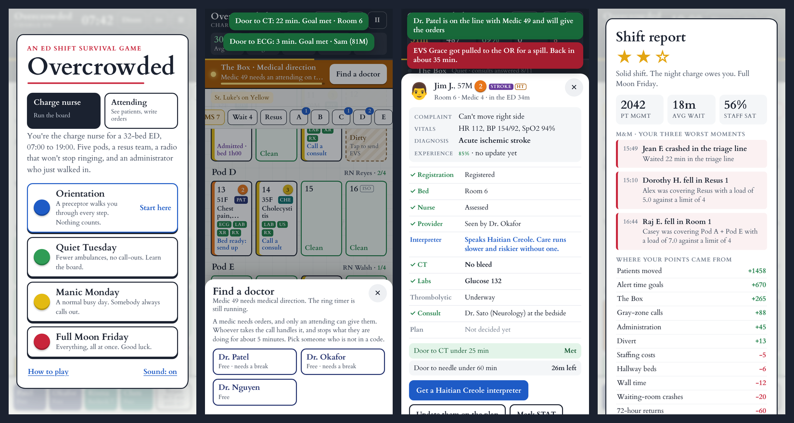

# Overcrowded: an ED shift survival game

You're the charge nurse for a 32-bed emergency department, 07:00 to 19:00. Patients come in by ambulance and through the front door, the radio keeps ringing, and an administrator just walked in. You direct every move: registration, triage, beds, providers, EVS, consults, and getting patients upstairs or out the door.

**Play it:** https://mussidik1.github.io/Overcrowded-ED-Game/

**New here? Start with Orientation.** A preceptor walks you through one patient at a time: a walk-in from registration to discharge, an ambulance patient through consult, admission, and report, a trauma alert with massive transfusion, a Box consult, a chest-pain call, chairs, waiting-room rechecks, an interpreter, breaks, an equipment outage, and a transfer. It lights up what to tap, holds the clock until you act, and fast-forwards through the waiting. Nothing counts against you.


## How a shift works

1. **Intake.** Walk-ins and EMS patients each need a quick registration and triage, and you direct both. Full registration happens later at the bedside. EMS crews wait on the wall until a nurse takes report. Walk-ins go to the waiting room after triage, where triage can miss: have a nurse recheck people who have waited, and walk the room to update them. Alerts and crashing patients can go straight to a bed.
2. **Beds.** Put triaged patients in rooms. ESI 1 goes to Resus, Fast Track opens at 09:00 and takes ESI 4 and 5, and airborne isolation needs Room 8 or 16. Rooms 19 and 20 are safe rooms. Six results-pending chairs free a bed for anyone a provider has already seen. Tap dirty rooms to send EVS.
3. **Providers.** Assign attendings, PAs, and NPs. PAs and NPs take ESI 2 to 5, with an attending co-sign on ESI 2. Intubations need an attending and an RT. A provider with a long line starts missing things. Station a provider in triage to work the waiting room.
4. **The Box.** Take EMS alert reports so teams are ready, and give medical direction on consult calls (General or Maryland MIEMSS question sets).
5. **Workup and treatment.** Techs draw labs and do ECGs, pharmacy verifies meds, respiratory therapy runs breathing treatments and vents, and the blood bank runs massive transfusion. Get interpreters for patients who need one.
6. **Disposition.** Discharge, consult and admit. Chest pain, fainting, and TIA patients come back with a risk score (HEART, Canadian Syncope Risk Score, ABCD2), and you make the home, observation, or admit call. Admitted patients wait for a bed upstairs, their nurse calls report, then you send them with a transporter or a tech; a hold nurse can take every admitted patient in the ED. Request transfers as soon as the diagnosis is clear, then book an ALS ambulance, critical care transport, or a helicopter; the patient holds the room until the crew arrives.

**When something breaks, divert for it.** The CT scanner, cath lab, trauma OR, lab, and power can go down mid-shift. Go on the matching status (CT Divert, STEMI Divert, Trauma Divert, or Internal Disaster) fast, and lift it when the fix is in. Yellow and Red Alert are for when the ED is full, but watch the neighbors: when three hospitals are on capacity alerts at once, the region suspends them all. The full-capacity protocol sends admitted patients to inpatient hallways when the ED is packed.

Along the way: nursing ratios (an active resuscitation takes a nurse and a half), a new grad who isn't ready for Resus, staff morale and breaks, call-outs and sick staff, angry consultants, admin demands, AMA, 72-hour returns, equipment downtime, and a mass-casualty bus crash.

**Scores:** average wait (door to provider), patient management, staff satisfaction, patients who left without being seen, and EMS wall time. The shift report at 19:00 gives you up to 3 stars, then walks you through your three worst moments and the decision behind each, the numbers an ED director answers for (door to provider, length of stay, boarding, LWBS and AMA rates, door to balloon), patient experience, and staffing hours.


A shift takes about 30 minutes at 1x, with 2x to 4x for quiet stretches. It saves on your device so you can come back to it.



## Box consult packs

- **General** (default): common online medical control questions, not tied to one state.
- **Maryland (MIEMSS):** written to the 2026 Maryland Medical Protocols for EMS (effective July 1, 2026). A teaching tool, not a protocol reference. Follow your current protocols.

## Development

The game ships as one self-contained `index.html`, with the engine, UI, styles, and fonts inlined. The source is in `src/`:

- `engine.js`: the simulation (no DOM)
- `ui.js`: the phone-first interface
- `style.css`, `index.template.html`

```sh
npm install      # fonts used by the build
npm run build    # writes index.html
npm test         # rule checks (three suites)
npm run sim      # simulated shifts at several player speeds
npm run stress   # 60 shifts, checks for stuck states
python3 test/ui_test.py      # taps through every system in headless Chrome (Playwright)
python3 test/train_test.py   # plays Orientation end to end by tapping only what the preceptor lights up
```


## Credits

Set in [Cardo](https://fonts.google.com/specimen/Cardo) by David Perry (SIL Open Font License 1.1), via Fontsource.
