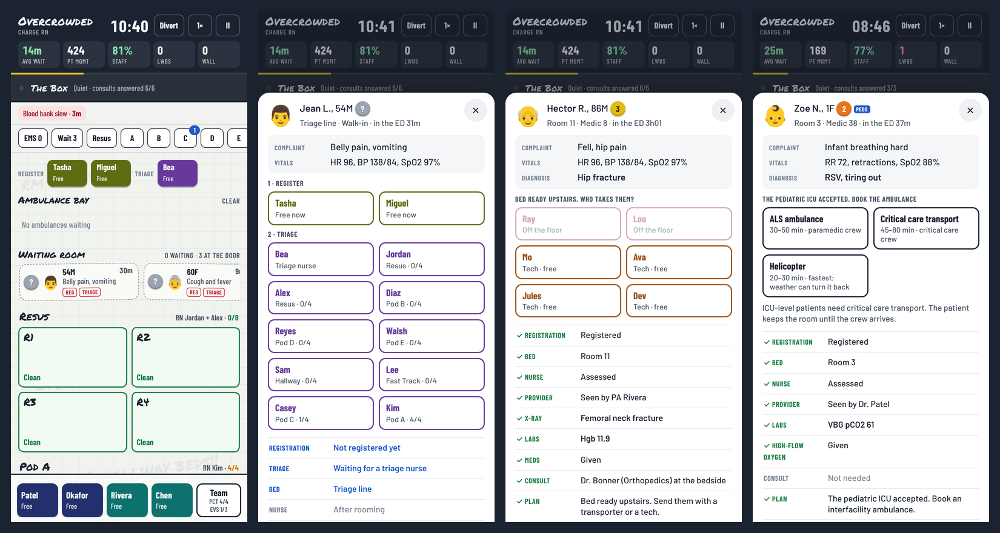

# Overcrowded: an ED shift survival game

You're the charge nurse for a 32-bed emergency department, 07:00 to 19:00. Patients come in by ambulance and through the front door, the radio keeps ringing, and an administrator just walked in. You direct every move: registration, triage, beds, providers, EVS, consults, and getting patients upstairs or out the door.

**Play it:** https://mussidik1.github.io/Overcrowded-ED-Game/



## How a shift works

1. **Intake.** Walk-ins and EMS patients each need registration and triage, and you direct both. EMS crews wait on the wall until a nurse takes report. Walk-ins go to the waiting room after triage. Alerts and crashing patients can go straight to a bed.
2. **Beds.** Put triaged patients in rooms. ESI 1 goes to Resus, Fast Track takes ESI 4 and 5, and airborne isolation needs Room 8 or 16. Rooms 19 and 20 are safe rooms. Tap dirty rooms to send EVS.
3. **Providers.** Assign attendings, PAs, and NPs; PAs and NPs take ESI 3 to 5. Station a provider in triage to work the waiting room.
4. **The Box.** Take EMS alert reports so teams are ready, and give medical direction on consult calls (General or Maryland MIEMSS question sets).
5. **Workup and treatment.** Techs draw labs and do ECGs, pharmacy verifies meds, respiratory therapy runs breathing treatments and vents, and the blood bank runs massive transfusion. Get interpreters for patients who need one.
6. **Disposition.** Discharge, consult and admit, then send admits upstairs with a transporter or a tech. For transfers, book an ALS ambulance, critical care transport, or a helicopter; the patient holds the room until the crew arrives.

Along the way: nursing ratios, staff morale and breaks, call-outs and sick staff, angry consultants, admin demands, AMA, 72-hour returns, Yellow and Red Alert, equipment downtime, and a mass-casualty bus crash.

**Scores:** average wait (door to provider), patient management, staff satisfaction, patients who left without being seen, and EMS wall time. The shift report at 19:00 gives you up to 3 stars.

A shift takes about 30 minutes at 1x, with 2x to 4x for quiet stretches. It saves on your device so you can come back to it.

## Box consult packs

- **General** (default): common online medical control questions, not tied to one state.
- **Maryland (MIEMSS):** written to the 2026 Maryland Medical Protocols for EMS (effective July 1, 2026). A teaching tool, not a protocol reference. Follow your current protocols.

## Development

The game ships as one self-contained `index.html`, with the engine, UI, styles, and fonts inlined. The source is in `src/`:

- `engine.js`: the simulation (no DOM)
- `ui.js`: the phone-first interface
- `style.css`, `index.template.html`

```sh
npm install      # fonts used by the build
npm run build    # writes index.html
npm test         # rule checks
npm run sim      # simulated shifts at several player speeds
npm run stress   # 60 shifts, checks for stuck states
python3 test/ui_test.py   # taps through every system in headless Chrome (Playwright)
```


