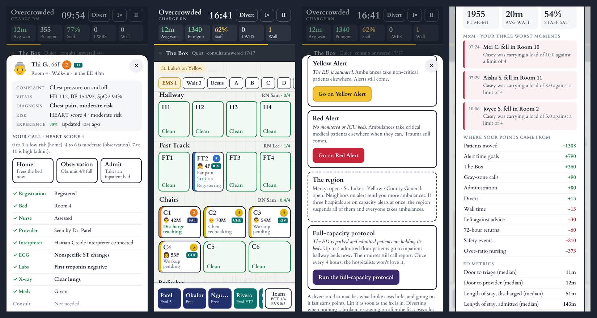
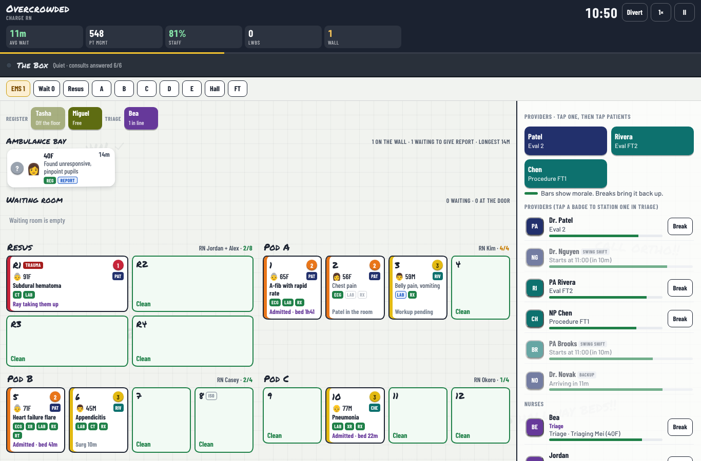

# Overcrowded: an ED shift survival game

A 32-bed emergency department, 07:00 to 19:00. Patients come in by ambulance and through the front door, the radio keeps ringing, and an administrator just walked in. Pick your role on the title screen:

- **Charge nurse.** You run the board: registration, triage, beds, providers, EVS, consults, and getting patients upstairs or out the door.
- **Attending.** The charge nurse runs the board. You see patients, write the orders, make the disposition call, and give EMS medical direction on the radio.

**Play it:** https://mussidik1.github.io/Overcrowded-ED-Game/

## The floor plan

The department is drawn from above: a bed in every room, chairs in the waiting room and the results area, a nurses' station, a break room, and the ambulance bay outside. Everyone on shift is a person on the floor. Nurses stand by their pods, providers sit at the station, techs, EVS, and transport go where the work is, and staff on break sit in the break room. EMS crews hold the wall with their patients until a nurse takes report. When the wall is full, the next ambulances back up in the driveway, each with its wait time.

Tap people, rooms, and pod signs the way you'd tap tiles on a list. Drag to move around; pinch or scroll to zoom. On a phone, hold it sideways. The list board is still there if you want it: switch on the title screen or in the pause menu.


**New here? Start with Orientation.** Each role has its own. It lights up what to tap, holds the clock until you act, and fast-forwards through the waiting. Nothing counts against you.

- **Charge nurse:** a preceptor walks you through a walk-in from registration to discharge, an ambulance patient through consult, admission, and report, a trauma alert with massive transfusion, routing a medical-direction call to a doctor, a chest-pain call, chairs, waiting-room rechecks, an interpreter, breaks, an equipment outage, and a transfer.
- **Attending:** a senior attending walks you through strep throat (see, order, discharge), DKA (treat what you find, admit to the ICU), appendicitis (a thin workup, the missing CT, call surgery), a medical-direction call on the radio, and a stroke alert from door to needle.


## How a shift works: charge nurse

1. **Intake.** Walk-ins and EMS patients each need a quick registration and triage, and you direct both. Full registration happens later at the bedside. EMS crews wait on the wall until a nurse takes report. Walk-ins go to the waiting room after triage, where triage can miss: have a nurse recheck people who have waited, and walk the room to update them. Alerts and crashing patients can go straight to a bed.
2. **Beds.** Put triaged patients in rooms. ESI 1 goes to Resus, Fast Track opens at 09:00 and takes ESI 4 and 5, and airborne isolation needs Room 8 or 16. Rooms 19 and 20 are safe rooms. Six results-pending chairs free a bed for anyone a provider has already seen. Tap dirty rooms to send EVS.
3. **Providers.** Assign attendings, PAs, and NPs. PAs and NPs take ESI 2 to 5, with an attending co-sign on ESI 2. Intubations need an attending and an RT. A provider with a long line starts missing things. Station a provider in triage to work the waiting room.
4. **The Box.** EMS calls come in two kinds. Alert reports are notifications: take the report so the team is ready. Medical direction needs a doctor: tap Find a doctor, pick an attending who isn't in a code, and they give the medic orders.
5. **Workup and treatment.** Techs draw labs and do ECGs, pharmacy verifies meds, respiratory therapy runs breathing treatments and vents, and the blood bank runs massive transfusion. Get interpreters for patients who need one.
6. **Disposition.** Discharge, consult and admit. Chest pain, fainting, and TIA patients come back with a risk score (HEART, Canadian Syncope Risk Score, ABCD2), and you make the home, observation, or admit call. Admitted patients wait for a bed upstairs, their nurse calls report, then you send them with a transporter or a tech; a hold nurse can take every admitted patient in the ED. Request transfers as soon as the diagnosis is clear, then book an ALS ambulance, critical care transport, or a helicopter; the patient holds the room until the crew arrives.

**When something breaks, divert for it.** The CT scanner, cath lab, trauma OR, lab, and power can go down mid-shift. Go on the matching status (CT Divert, STEMI Divert, Trauma Divert, or Internal Disaster) fast, and lift it when the fix is in. Yellow and Red Alert are for when the ED is full, but watch the neighbors: when three hospitals are on capacity alerts at once, the region suspends them all. The full-capacity protocol sends admitted patients to inpatient hallways when the ED is packed.

Along the way: nursing ratios (an active resuscitation takes a nurse and a half), a new grad who isn't ready for Resus, staff morale and breaks, call-outs and sick staff, angry consultants, admin demands, AMA, 72-hour returns, equipment downtime, and a mass-casualty bus crash.

**Charge nurse scores:** average wait (door to provider), patient management, staff satisfaction, patients who left without being seen, and EMS wall time. The shift report at 19:00 gives you up to 3 stars, then walks you through your three worst moments and the decision behind each, the numbers an ED director answers for (door to provider, length of stay, boarding, LWBS and AMA rates, door to balloon), patient experience, and staffing hours.



## How a shift works: attending

1. **Pick up patients.** Rooms marked Needs a provider are waiting for a doctor. Tap one, then See this patient. See the sickest first. Leave someone too long and another provider picks them up.
2. **Write orders.** After your exam, pick tests (ECG, labs, X-ray, CT, ultrasound) and treatment (medications, fluids, antibiotics, insulin, a thrombolytic, epinephrine, naloxone, breathing support, intubation, blood, massive transfusion, laceration repair), then sign. Order what they need and nothing extra. Extra tests cost time and points, a CT costs the most, and some treatments hurt people who don't need them.
3. **Close the gaps.** If the workup can't make the diagnosis, add what's missing. A patient who isn't improving needs a treatment you didn't order, and twenty minutes untreated goes on the M&M list.
4. **Make the call.** Discharge, call the right consultant to admit, or transfer. Chest pain, fainting, and TIA come with a risk score for home, observation, or admit. Sending a sick patient home is the worst call you can make.
5. **The radio.** When a medic needs medical direction, it rings for you. Answer, read the call, approve or deny. Alert reports go to the charge nurse.
6. **Alerts.** Your orders and your speed decide the time goals: ECG in 10, CT in 25, needle in 60, balloon in 90. Activate massive transfusion for a trauma that's bleeding out, even before they arrive.

The attending's score counts patients seen, clean order sets, right calls, time goals, and medical direction. Patients waiting on your orders or your decision cost you. The shift report lists your patients and your worst moments, not the nursing numbers.


A shift takes about 30 minutes at 1x, with 2x to 4x for quiet stretches. It saves on your device so you can come back to it.


## Medical direction packs (attending)

- **General** (default): common online medical control questions, not tied to one state.
- **Maryland (MIEMSS):** written to the 2026 Maryland Medical Protocols for EMS (effective July 1, 2026). A teaching tool, not a protocol reference. Follow your current protocols.

## Development

The game ships as one self-contained `index.html`, with the engine, UI, styles, and fonts inlined. The source is in `src/`:

- `engine.js`: the simulation (no DOM)
- `ui.js`: the phone-first interface
- `map.js`: the floor plan (SVG), built into `ui.js`
- `style.css`, `index.template.html`

```sh
npm install      # fonts used by the build
npm run build    # writes index.html
npm test         # rule checks (four suites; rules4 covers the attending)
npm run sim      # simulated shifts at several player speeds
npm run stress   # 60 shifts, checks for stuck states
python3 test/ui_test.py      # taps through every system in headless Chrome (Playwright)
python3 test/md_ui_test.py   # the attending: see, order, decide, the radio, the report
python3 test/map_test.py     # the floor plan: taps on the floor, panning, ambulances backing up, turning the phone
python3 test/train_test.py   # plays the charge nurse Orientation on the floor plan, tapping only what the preceptor lights up
MODE=md python3 test/train_test.py   # the same for the attending Orientation
VIEW=list python3 test/train_test.py # either Orientation on the list board
```



## Credits

Set in [Cardo](https://fonts.google.com/specimen/Cardo) by David Perry (SIL Open Font License 1.1), via Fontsource.
